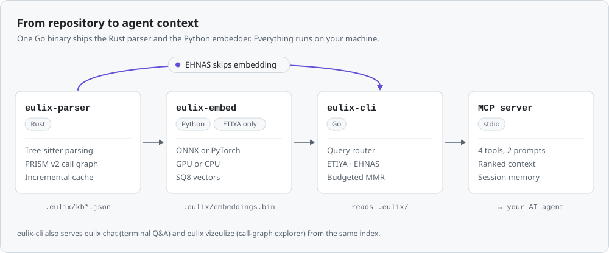
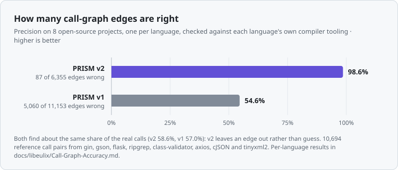
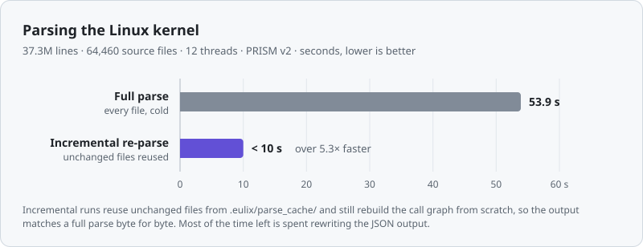
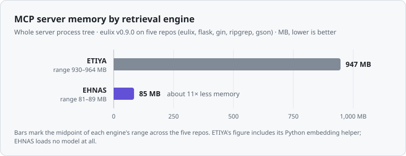

<div align="center">

<picture>
  <source media="(prefers-color-scheme: dark)" srcset="https://github.com/user-attachments/assets/fe2f0f29-7fc1-4f6e-9a6d-0a0a1268a171">
  
</picture>

# A map of code you've never read, for you and your agent.

Ask *who calls this* or *how does A reach B* and get one complete answer from the call graph, on your machine, with no build step or GPU.

[](changelog.md)
[](LICENSE)
[](docs/eulix-cli/mcp/Overview.md)

[**Why Eulix**](#-why-eulix-code-nobody-has-explained-to-you) · [**See a real reply**](#-what-your-agent-gets-back) · [**Quick start**](#-quick-start) · [**Benchmarks**](#-benchmarks) · [**Docs**](docs/README.md)

<sub>Works with Claude Code, Cursor, Windsurf, Cline, Continue, LM Studio and other MCP clients.</sub>

</div>

<!--
  30-second side-by-side clip slot: the same question to Claude Code without and
  with Eulix. Record it with
      .github/readme/demo/sidebyside.sh <task-id> bench/results/agent/<run-id>
  upload sidebyside-{dark,light}.gif to GitHub, and put them here as a <picture>
  in place of (or above) the teaser below. The captions come from the benchmark
  run, and the README text under the clip must say which task it is and link the
  full results, since one task is not the average.
-->

<p align="center">
<a href="https://github.com/user-attachments/assets/5c6cedc8-4ff4-4626-a90c-2eaaa2c7f3fd">
<picture>
<source media="(prefers-color-scheme: dark)" srcset="https://github.com/user-attachments/assets/2e492176-e9ac-4353-84c5-5a4c8a55f1b6">

</picture>
</a>
<br><sub>▶ Click for the full 2-minute walkthrough</sub>
</p>

<br>

|              💸 −6%              |        📦 1.6M lines         |          🎯 98.6%           |      ⚡ < 20 ms      |              🐧 53.9 s              |
| :------------------------------: | :--------------------------: | :-------------------------: | :------------------: | :---------------------------------: |
| agent cost, with the same 13/13 correct answers | of bifrost indexed in 5.7 s | of call-graph edges are right | per warm query (p50) | to parse the Linux kernel (37.3M lines) |

<sub>Agent figures: Claude Code with Claude Sonnet 5.5 (medium effort), 13 questions on bifrost, with and without Eulix. Call-graph figure: eight open-source projects, one per language, checked against each language's own compiler tooling. Query figure: v0.9.0 with no embeddings on five open-source repos, Ryzen 5 5600X. Kernel figure: 12 threads. Details in [Benchmarks](#-benchmarks).</sub>

---

## 🎯 Why Eulix: code nobody has explained to you

On a repository you know, you remember where things are. On one you don't (a new job, a dependency you have to debug, a codebase newer than your model's training data), every question starts with a search. Grep matches strings. It can't tell you who calls a function, which of five `validate()` methods a call means, or whether you have found every caller. Eulix answers those from structure: it parses the repository once into symbols, scopes and a call graph, then answers from that index on your own machine.

**For AI agents.** An agent on unfamiliar code greps, opens a file, greps again and backs out of dead ends. Every step is a model turn, and every result stays in context for the rest of the session. With Eulix it asks the question as a tool call and gets a short, complete answer: a `callers` reply is about 110 tokens, one line per call site, and ends with `complete: yes`, so the agent doesn't re-check with grep. Measured with Claude Code (Claude Sonnet 5.5) on bifrost, a Go codebase from November 2026 with 1.6 million lines in 3,242 files:

| 13 questions on bifrost | Cost (list price) | Output tokens | Time | Correct |
| :-- | --: | --: | --: | :-: |
| Grep and file reads only | $7.34 | 186k | 298 s | 13/13 |
| With Eulix | $6.92 (**−6%**) | 150k (−20%) | 284 s | 13/13 |

- Eulix was cheaper on 11 of the 13 questions. Its index of the whole repository took 5.7 s to build.
- The questions about structure gain most. In a separate run on four repos, *what calls X* questions cost **27% less**. *Where is X* questions were about even, since grep is already good at finding a name.
- Agents rarely call Eulix unless told to. `eulix mcp install` registers the server and adds the one-line hint that the numbers above use.
- One session per setup, so a few percent either way per question is noise. A call through a struct field, goroutine or callback has no edge in the call graph yet, and the first version of these tools cost 18–40% *more* than grep. [Every run, the method and its limits ↓](#agent-token-use-claude-code-with-and-without-eulix)

**For people.** The same index answers you directly. `eulix vizeulize` opens the call graph in your browser, searchable and served from `127.0.0.1`. `eulix chat` answers questions in the terminal with a local model (Ollama, LM Studio, vLLM) or a hosted one. [`eulix-lsp`](eulix-lsp/README.md) (beta) brings definitions, references and call hierarchy into your editor without a build.

**Local, fast and without a model.** Indexing reads only your source: no build step, no type checker, no GPU, no network. With the EHNAS engine no neural model runs at all, the MCP server uses under 90 MB and a warm query takes under 20 ms. Your code never leaves the machine.

| The grep loop                                                                                                        | Eulix                                                                                        |
| :------------------------------------------------------------------------------------------------------------------- | :------------------------------------------------------------------------------------------- |
| **Slow.** Every guess is another tool call and another model turn.                                                   | **One call.** The agent asks a question and gets the answer back.                            |
| **Burns tokens.** File reads and raw match lists pile up in context and ride along on every later turn.              | **Budgeted.** Each reply fits a per-question budget, with a `file:line` reference per item.  |
| **Misses context.** grep matches strings. It can't tell who calls a function or which `validate()` a call refers to. | **Structural.** Lookups run against a symbol index and a call graph built from the AST.      |
| **Never knows it's done.** Grep can't say whether it found every caller.                                             | **Says when it's complete.** Every reply starts with `complete: yes` or `complete: no`.      |

<details>
<summary>Why not embedding-based RAG?</summary>

Embeddings move the cost somewhere else. Every question waits on a model forward pass before search can start, the embedding model stays resident in memory, and every code change means re-embedding. Indexing is where it hurts most: on the Linux kernel, embedding 837,531 chunks took 26 minutes on a consumer GPU, while parsing the whole tree and building its call graph took 54 seconds. Eulix's own embedding engine, ETIYA, pays the same toll at query time too: about a second and close to 1 GB of memory before its first answer. And generic chunkers split code by token count, so a function can land in two halves, while the structure that answers most code questions never reaches the index. Eulix keeps embeddings optional: ETIYA adds them on top of the structural index for semantic recall, and EHNAS answers from structure alone.

</details>

## 🔍 What your agent gets back

A real reply from the bifrost benchmark. The agent asked `callers` for `Bifrost.shouldTryFallbacks`:

```text
answer: callers · source: call graph (exact, static) · complete: yes
callers of Bifrost.shouldTryFallbacks (core/bifrost.go:5874): 2 call sites + 1 in tests, complete
  core/bifrost.go:6193  Bifrost.handleRequest        shouldTryFallbacks := bifrost.shouldTryFallbacks(ctx, req, primaryErr)
  core/bifrost.go:6425  Bifrost.handleStreamRequest  shouldTryFallbacks := bifrost.shouldTryFallbacks(ctx, req, primaryErr)
  (tests: core/bifrost_test.go:8845)
```

That one call answered the question. The first line says where the answer came from and that the list is complete, so the agent stopped there.

| Tool | Answers | Typical reply |
| :-- | :-- | :-- |
| `callers` / `callees` | Who calls X, what X calls | One line per call site |
| `definition` | Where X is defined, with its signature and optionally its body | A few lines |
| `trace` | How A reaches B across files: the call path, then the code along it | Path plus ranked code |
| `search` | How a feature works: ranked code chunks for a question in words | Up to about 2,000 tokens |
| `query` | Any question, routed to the right strategy (the original tool) | Sized to `max_tokens` |

`search` and `query` replies are ranked code chunks. Here is one (trimmed) from the EHNAS engine, for a question about Eulix's own source, _"Who calls ResolveEngine, and where is the engine chosen?"_

```text
Context: 15 source chunks, 0 metadata, 2067 tokens across 8 files

── SOURCE ──

[1] eulix-cli/internal/query/retrieval/engine.go:56-68 (score 0.90)
func ResolveEngine(raw string) (Engine, error) {
    switch s := strings.ToLower(strings.TrimSpace(raw)); s {
    case "":
        return engineDefault, nil
    …

[2] eulix-cli/internal/query/retrieval/engine.go:104-121 (score 0.90)
func (cb *ContextBuilder) InitEngine() error {
    …
    eng, err := ResolveEngine(cb.config.Project.Engine)
    …

… 13 more chunks
```

Every chunk arrives with its file, line range and score, so the agent can cite it, open it or build its next question on it. The header line states what the reply costs before the agent reads a single chunk.

- **Ranked and budgeted.** Candidates are scored, merged and picked with MMR, which weighs relevance against redundancy, until the budget is spent.
- **Warm between calls.** The server keeps the index in memory, frees it after 5 idle minutes and switches repositories on demand with `set_repo_path`.
- **Read-only.** The query tools are marked read-only, so a client can run them without write permissions.

### Tell Eulix what your agent already knows

`search` and `query` take an optional `known_symbols` list: function names, class names or file paths the agent has already met in this session, in code it read, an earlier reply or your own message. Those names change how Eulix searches. A question with no anchors goes to open-ended retrieval. A question with anchors starts with a multi-hop lookup that begins at those symbols and follows their edges through the call graph, so a vague question becomes a precise one.

```json
{
  "name": "search",
  "arguments": {
    "question": "Where is the retrieval engine chosen?",
    "known_symbols": ["ResolveEngine", "InitEngine"]
  }
}
```

The server also keeps a small memory per project. When an answer scores well, the symbols around it are remembered and added to later queries on the same repository, so the session gets sharper as it goes. Asked a second time, the question above came back as 10 chunks from `engine.go` alone, in 1,521 tokens instead of 2,067.

<details>
<summary>How the MCP server picks a search strategy</summary>

Each query runs a cascade and stops at the first stage whose result scores at least 0.55. If no stage gets there, the best-scoring result is returned.

| Stage         | Runs when                                              | What it does                                                                |
| :------------ | :----------------------------------------------------- | :-------------------------------------------------------------------------- |
| 1. Multi-hop  | The question or `known_symbols` names a symbol or path | Searches from those anchors plus related symbols from the project memory    |
| 2. Open-ended | Stage 1 didn't settle it                               | Plain retrieval from the question alone                                     |
| 3. Anchored   | Stage 2 surfaced anchors of its own                    | Asks again with those anchors, turning a vague question into a concrete one |
| 4. Lexical    | Nothing above scored well enough                       | Text search across the repository's files, labelled as such in the reply    |

Only results that clear the quality bar feed the project memory, so a fallback never teaches it anything.

</details>

## 🚀 Quick start

Three steps from install to your agent's first query.

### 1. Install

**Linux and macOS** (Apple Silicon)

```bash
bash <(curl -fsSL https://raw.githubusercontent.com/Nurysso/eulix/main/install.sh)
```

**Windows** (PowerShell)

```powershell
irm https://raw.githubusercontent.com/Nurysso/eulix/main/install.ps1 | iex
```

**Intel Mac or Linux on ARM:** [build from source](docs/Installation.md#build-from-source).

The installer detects your GPU and picks the build without asking: NVIDIA CUDA when it finds an NVIDIA driver, the CPU build otherwise (it also drives AMD GPUs). It verifies the Eulix binary against the release checksums. Set `EULIX_GPU=cpu` or `EULIX_GPU=nvidia` to skip detection.

### 2. Index your repository

```bash
cd your-repo
eulix init      # writes eulix.toml and .euignore (short wizard)
eulix analyze   # parses and builds the call graph; ETIYA also embeds
```

> [!TIP]
> **Want the embedding-free setup?** Before running `eulix analyze`, add one line under the `[project]` table in `eulix.toml`:
>
> ```toml
> engine = "ehnas"   # default: "etiya"
> ```
>
> `analyze` then stops after parsing, and the MCP server never loads a model.

### 3. Connect your agent

**Claude Code, Cursor or Cline.** Run this in the repo:

```bash
eulix mcp install claude     # or cursor, cline
```

It registers the MCP server for the project and adds a one-line hint to the agent's instructions (for Claude Code, a block in `CLAUDE.md`) saying when to use each tool. Agents rarely call Eulix without that hint, and the benchmark figures above use it.

**Any other MCP client** (Windsurf, Continue, LM Studio, …), or to register it by hand:

```bash
claude mcp add eulix -- eulix mcp --repo "$PWD"
```

```json
{
  "mcpServers": {
    "eulix": {
      "command": "eulix",
      "args": ["mcp", "--repo", "/absolute/path/to/your-repo"]
    }
  }
}
```

> [!TIP]
> If your client can't find `eulix`, set `command` to the absolute path from `which eulix`. Setup notes for Continue, LM Studio and the MCP Inspector are in the [MCP server README](eulix-cli/internal/mcp/README.md#connecting-a-client).

Your agent now has `callers`, `callees`, `definition`, `trace` and `search`, plus the routed `query` tool and `set_repo_path`.

<!-- No agent handy? Call them by hand in your browser:
```bash
npx @modelcontextprotocol/inspector eulix mcp --repo "$PWD"
``` -->


## ✨ Core features

### ⭐ PRISM v2: precise call graphs from syntax alone

Every navigation question eventually turns into this one: when the code says `validate()`, which `validate` does it mean? A compiler answers with full type information, which needs a working build. PRISM v2 answers from syntax alone, and that is how it covers nine languages and the entire Linux kernel in under a minute.

`libeulix` parses each file with Tree-sitter and approximates the call graph straight from the syntax tree. It needs only your source: no build step and no type checker. Each call resolves outward from where it is made, checking the same file, then its imports, then the same directory, then the whole project. Method calls are receiver-aware in Python, TypeScript, Rust, Go and Java: `self.save()` starts at the enclosing class and walks up through its parents, and in Go and Java a receiver's type is read from its declaration. When a name is too common to guess, PRISM leaves the edge out, because a missing edge misleads retrieval less than a wrong one.

- **Precise:** 98.6% of the call edges it draws are right, checked against each language's own compiler tooling on eight open-source projects ([results](#call-graph-accuracy-prism-v2)). PRISM v1 got 54.6% on the same code.
- **Fast:** the Linux kernel (37.3M lines) parses, call graph included, in 53.9 s.
- **Incremental:** re-runs reuse every unchanged file from a parse cache, so the whole kernel re-parses in under 10 s, with output identical to a full parse.
- **Deterministic:** every grammar walks its syntax tree without recursion, and every output comes out in the same order on every run.
- **Languages:** C · C++ · Go · Java · JavaScript · PHP · Python · Rust · TypeScript

### ⭐ EHNAS: zero embeddings, zero GPU, zero network

> [!TIP]
> **EHNAS needs zero embeddings, zero GPU and zero network.** Set `engine = "ehnas"` and `eulix analyze` skips the embedding stage entirely ([see Quick start](#-quick-start)).

EHNAS (_Exact · Hierarchical · Node · Structure_) treats a codebase as what it is: a graph of symbols and calls, often with the same logic written in more than one language, feeding a context window that has to be spent well. Its deterministic core handles exact matches, path gating, subsystem boosting and scope demotion. Three layers on top handle what a single-hop search can't, and structural MMR picks the final set:

- **Monte Carlo walk.** 256 walkers start from the strongest hits and wander the call graph and the symbol and word co-occurrence graphs, following dependency chains several files deep. Common symbols end a walk sooner, so boilerplate has little pull on the search.
- **Twin search.** Each chunk gets a 64-bit structural signature from its kind and its set of symbols. Chunks that share a signature in different languages are twins, so a hit in a Go client can surface the same logic in a Python service, for the price of one hash lookup.
- **Novelty packing.** As the context fills, each candidate is scored by how many of its symbols the reply already holds, and the bar for "new" rises with every pick. The last tokens of the budget buy code the reply doesn't already contain.

Nothing in that pipeline is a neural model, so EHNAS needs no embedding stage, no GPU and no network:

- **Fast to index:** `eulix analyze` stops after parsing, so a typical repo is ready in seconds and the whole Linux kernel in about a minute.
- **Light:** the MCP server answers its first question in under 0.2 s and uses about a tenth of the memory of the embedding engine.
- **CPU-only:** no model is loaded while indexing or serving, so any laptop can run it.
- **Explainable:** each layer's contribution to a score shows up in the debug trace.

### 🧠 ETIYA: semantic retrieval with embeddings

ETIYA (_Embedding-aware Topological Indexing for Your Architecture_) is the default engine. It runs every structural strategy EHNAS runs (exact and partial symbol matches, BM25 keyword search, call-graph expansion) and adds vector similarity on top, so retrieval can connect a question to code that shares none of its words. A local embedding helper embeds each question (callers-and-callees lookups skip it), and query-aware MMR balances relevance against redundancy in the final pick.

Vectors are built on your machine during `eulix analyze` and stored as 8-bit SQ8: one signed byte per dimension plus a scale. They load into one flat matrix, aligned to 2 MiB huge pages on Linux. Past 50,000 vectors, an IVF index (256 clusters) builds in the background, so the engine answers right away and switches to the faster search once the index is ready.

#### Choosing an engine

|                                              | ETIYA _(default)_      | EHNAS                                                  |
| :------------------------------------------- | :--------------------- | :----------------------------------------------------- |
| Reaches code with no words in common through | Vector similarity      | Twin search and a Monte Carlo walk over the code graph |
| Embedding stage in `eulix analyze`           | Yes                    | No                                                     |
| Model at query time                          | Local embedding helper | None                                                   |
| Final selector                               | Query-aware MMR        | Structural MMR                                         |
| First answer after start-up                  | 1.03–1.09 s            | 0.13–0.16 s                                            |
| MCP server memory                            | 930–964 MB             | 81–89 MB                                               |

Switch with one line under `[project]` in `eulix.toml`: `engine = "ehnas"` or `engine = "etiya"`.

### 🛡️ Local-first

Parsing, indexing, embedding and retrieval all run on your hardware. The MCP server never calls a model and never uploads your code; your agent decides what it sends to its own model. Eulix needs no account or API key, and it collects no telemetry.

It also stays inside the repository you point it at. MCP and retrieval skip hidden files, anything matched by `.euignore` and paths that escape the repo through symlinks. The installer checks the Eulix binary against the release checksums, and the binary checks its embedded parser against a hash compiled into the build before running it.

## 🧩 Architecture

<p align="center">
  
</p>

Eulix is three programs in three languages, each picked for its job and shipped as one binary. `eulix analyze` runs the first two; every query runs through the third.

- **Rust · `eulix-parser` on `libeulix`.** Parses every source file with Tree-sitter grammars for nine languages, extracts functions, classes, methods, imports and call sites, and resolves calls with PRISM v2. A spill-to-disk writer keeps peak memory near 3.7 GB on the full kernel, and a parse cache makes re-runs incremental. It writes eight JSON files to `.eulix/`, among them `kb.json` (symbols), `kb_index.json` (lookup indexes), `kb_call_graph.json` (the call graph) and `kb_summary.json` (the project summary).
- **Python · `eulix-embed`.** Runs only when the retrieval engine is ETIYA. It chunks the knowledge base, embeds the chunks with ONNX Runtime (default) or PyTorch on GPU or CPU, and writes SQ8-quantized vectors to `embeddings.bin` and `vectors.bin`.
- **Go · `eulix-cli`.** The `eulix` binary you install. It carries the parser and the embedder inside it, unpacks them on first run and checks the parser against a hash compiled into the build. It routes each question, runs the ETIYA or EHNAS engine, and serves `eulix mcp`, `eulix chat` and `eulix vizeulize` from the same index.
- **MCP server · `eulix mcp`.** Speaks the Model Context Protocol over stdio. Agents get typed tools (`callers`, `callees`, `definition`, `trace`, `search`), the routed `query` tool and `set_repo_path`, plus two prompts. Every reply starts with a `complete: yes|no` line and fits a per-question budget. It keeps the index warm between calls and never calls a model itself.

<details>
<summary>Text version of the diagram</summary>

```text
 your repository
        │
        ▼
 eulix_parser   Rust · libeulix · Tree-sitter · PRISM v2
        │       symbols, scopes, call graph       →  .eulix/kb*.json
        ▼
 eulix_embed    Python · ONNX Runtime (default) or PyTorch · ETIYA only
        │       SQ8 vectors                       →  .eulix/embeddings.bin
        ▼
 eulix          Go · retrieval engines: ETIYA │ EHNAS
        │
        ├──►  eulix mcp         MCP server for AI coding agents
        ├──►  eulix chat        terminal Q&A with a local or hosted model
        └──►  eulix vizeulize   call-graph explorer in your browser
```

</details>

### Embedders

| Backend          | Setting                         | Why pick it                                                          |
| :--------------- | :------------------------------ | :------------------------------------------------------------------- |
| **ONNX Runtime** | `engine = "onnx"` _(default)_   | Lighter and faster to start, with no PyTorch at inference time.      |
| **PyTorch**      | `engine = "torch"` _(optional)_ | More devices, including Apple MPS, and models that need custom code. |

Both run on GPU or CPU and produce comparable vectors for the same model. Embeddings are built only when the retrieval engine is ETIYA. The default model is [`BAAI/bge-base-en-v1.5`](https://huggingface.co/BAAI/bge-base-en-v1.5) (768 dimensions).

```toml
# excerpt of eulix.toml
[project]
engine = "etiya"                  # retrieval engine: "etiya" (default) or "ehnas"

[embeddings]
model  = "BAAI/bge-base-en-v1.5"
engine = "onnx"                   # embedder: "onnx" (default) or "torch"

[llm]
max_tokens = 8192                 # replies are sized to fit this budget
```

### Also in the box

| Tool                                            | What it does                                                                                                 |
| :---------------------------------------------- | :----------------------------------------------------------------------------------------------------------- |
| `eulix chat`                                    | Terminal Q&A over your repo with a local model (Ollama, LM Studio, vLLM) or a hosted provider you configure. |
| `eulix vizeulize`                               | Interactive, searchable call graph in your browser, served from `127.0.0.1`.                                 |
| [`libeulix`](https://crates.io/crates/libeulix) | The parser and PRISM engine as a Rust crate: `cargo add libeulix`.                                           |
| [`eulix-lsp`](eulix-lsp/README.md)              | Language server built on libeulix (beta): definitions, references, hover, call hierarchy.                    |

## 📊 Benchmarks

> Local engineering runs. Results vary with hardware, repository, configuration and query shape. Method: [Benchmarking](docs/Architecture/Benchmarking.md) and [Call-Graph Scoring](docs/Architecture/Call-Graph-Scoring.md). Raw v0.9.0 numbers: [benchmark report](bench/results/v0.8.3-vs-f9006ea.md) and [call-graph accuracy](docs/libeulix/Call-Graph-Accuracy.md).

### Agent token use: Claude Code with and without Eulix

Questions a developer might ask about an unfamiliar repo (*what calls X*, *where is X*, *trace a flow*, a config lookup, and longer multi-file questions), asked of Claude Code (Claude Sonnet 5.5) with grep alone and with Eulix plus the one-line hint that `eulix mcp install` writes. Method, every run and its limits: [Agent Benchmark](docs/Architecture/Agent-Benchmark.md).

**Current MCP tools, on bifrost.** [Bifrost](https://github.com/maximhq/bifrost) at a commit from 2026-11-19 is a Go codebase of 1.6M lines (3,242 files, indexed in 5.7 s) newer than the model's training data, so the agent has to read the code instead of answering from memory. 13 questions were asked in one long session per setup (10 regular, 3 deep), at medium effort:

| Setup | Input tokens | Output tokens | Cost (list price) | Time | Correct answers |
| :-- | --: | --: | --: | --: | :-: |
| No Eulix | 17.65M | 186k | $7.34 | 298 s | 13/13 |
| Eulix + hint | 17.92M (+2%) | 150k (−20%) | $6.92 (**−6%**) | 284 s | 13/13 |

- **Cheaper on 11 of 13 questions**, by 4–16%, at the same accuracy. The saving comes from the agent reasoning and writing less. Input tokens are about the same, because both sessions carry the same growing conversation.
- **Structural questions gain most.** In a separate low-effort run with one session per question on all four repos (19 questions), callers questions cost 27% less with Eulix, and all questions together cost 5% less. A `callers` reply is about 110 tokens, one line per call site, ending in `complete: yes` so the agent doesn't re-check with grep. "Where is X" questions were about even (+3%).
- **Opus 4.8 on bifrost.** One session per question, all 15 questions (10 regular, 5 deep): **$6.78 with Eulix against $8.67 without (−22%)**, 14/15 correct against 13/15. Savings were largest on traces and deep questions (−22% to −48% each) and nil on small lookups. [Run summary](bench/results/agent/2026-11-20-opus48-bifrost/SUMMARY.md).
- **Limits.** A call through a struct field, goroutine or callback has no edge in the call graph. At low effort that sent one trace answer down the wrong path. Most figures come from one session per question, so per-question differences of a few percent are noise. Results: [bifrost, Opus 4.8](bench/results/agent/2026-11-20-opus48-bifrost/SUMMARY.md) · [bifrost, chained](bench/results/agent/2026-11-20-bifrost-chain-medium/SUMMARY.md) · [four repos, low effort](bench/results/agent/2026-11-20-sonnet55-low-mcp2/SUMMARY.md).

**Before the typed tools (v0.9.0 MCP, one `query` tool).** Ten questions on Flask 3.1.3, Django 6.1.3 and ripgrep 15.2.0, each asked five times in each of three setups: no Eulix; Eulix added with `claude mcp add` and nothing else; and Eulix plus one line telling the agent to query it first. Figures are sums of per-task medians.

| Setup | Input tokens | Cost (list price) | Tool calls | Correct answers |
| :-- | --: | --: | --: | :-: |
| No Eulix | 330,451 | $0.348 | 42 | 50/50 |
| Eulix added, no hint | 337,277 (+2%) | $0.350 (+1%) | 37 | 50/50 |
| Eulix + "query Eulix first" | 450,073 (+36%) | $0.409 (+18%) | 29 (−31%) | 50/50 |

- **No saving then.** Every setup answered every question correctly. With the hint, the agent used fewer tool calls but read more tokens, so it paid more.
- **Unprompted, the agent rarely uses Eulix.** With Eulix installed and no hint, Claude called it in 5 of 50 sessions and grepped in the rest. A CLAUDE.md line is needed for the agent to use it.
- **Replies are large.** The median Eulix reply was about 5,600 tokens. With the hint, Claude queried Eulix in 40 of 50 sessions and answered from that reply alone in 12. In the rest it made a median of 3 more tool calls to check.
- **Where it helped.** Cost went down on four tasks with the hint. The clearest case: on *trace how ripgrep turns its arguments and config file into HiArgs*, Eulix cut input tokens by 43% and cost by 18%, answering in one call instead of five.
- **A repo the model knows less well shows the same pattern.** On [bifrost](https://github.com/maximhq/bifrost) at a commit from 2026-11-19 (a large Go codebase), ten more questions gave the same result. With the hint, input tokens rose 40–41% and cost 32–40%, in a partial default-effort run (54 sessions, cut short by a usage limit) and a low-effort run (20 sessions). Eulix replies there were again about 5,700 tokens. Those runs have only 1–2 sessions per task, so per-task differences are noise. Results: [default effort](bench/results/agent/2026-11-20-sonnet-bifrost/report.md), [low effort](bench/results/agent/2026-11-20-sonnet-low-bifrost/report.md).

<sub>Run `2026-11-20-sonnet`: Claude Code 2.1.328, Eulix v0.9.0 with no embeddings, five reps per task and setup, isolated sessions (no user settings, plugins or other MCP servers). Per-task table, every answer and the grading rubric: [report](bench/results/agent/2026-11-20-sonnet/report.md) · method and limits: [bench/agent](bench/agent/README.md).</sub>

### Call-graph accuracy (PRISM v2)

<p align="center">
  
</p>

Every edge PRISM draws was checked against the call sites that each language's own tooling resolves: go/types for Go, javac for Java, jedi for Python, rust-analyzer for Rust, the TypeScript checker for TypeScript and JavaScript, and libclang for C and C++. Across the eight projects, v2 drew 6,355 edges and got 87 wrong. The calls it misses are mostly method calls whose receiver type isn't written in the source; PRISM leaves those out rather than guess.

<details>
<summary>View raw benchmark data: call graphs</summary>

| Language   | Project                | Precision | Recall |
| :--------- | :--------------------- | --------: | -----: |
| C          | cJSON 1.7.19           |    100.0% |  99.8% |
| Java       | gson 2.15.0            |    100.0% |  97.3% |
| TypeScript | class-validator 0.15.1 |    100.0% |  90.3% |
| JavaScript | axios 1.21.1           |     91.5% |  82.8% |
| Python     | flask 3.1.3            |     98.2% |  74.0% |
| Go         | gin 1.12.0             |    100.0% |  66.3% |
| C++        | tinyxml2 11.0.0        |     90.0% |  56.0% |
| Rust       | ripgrep 15.2.0         |     98.8% |  34.3% |

PRISM v2 at `62fdddf`. PHP isn't measured: there is no PHP toolchain in the reference set. Per-call-kind results, the v1 comparison and what each language misses are in [Call-Graph Accuracy](docs/libeulix/Call-Graph-Accuracy.md). Reproduce with `make bench-callgraph`.

</details>

### Parsing the Linux kernel

<p align="center">
  
</p>

A cold run parses all 64,460 source files (37.3M lines) on 12 threads in 53.9 seconds with zero failures, and links them into a graph of 774,876 nodes and 1,506,441 edges. From then on, re-runs reuse every unchanged file from `.eulix/parse_cache/` and rebuild the call graph and indexes from scratch, so the output matches a full parse byte for byte. Most of the remaining time goes to rewriting the JSON output, not to parsing or analysis.

<details>
<summary>View raw benchmark data: parser</summary>

**64,460 files · 37.3M lines · 0 failures · 53.9 seconds** (eulix-parser v0.9.0, 12 threads, PRISM v2, median of 3 cold runs)

| Metric             |         Result |
| ------------------ | -------------: |
| Source files found |     **64,460** |
| Failed             |          **0** |
| Lines of code      | **37,322,695** |
| Functions          |    **647,514** |
| Classes            |    **211,297** |
| Methods            |      **7,978** |
| Graph nodes        |    **774,876** |
| Graph edges        |  **1,506,441** |
| **Parser total**   |    **53.85 s** |

**Phase timings and memory** (median run)

| Phase                  |    Time |          Peak RSS |
| ---------------------- | ------: | ----------------: |
| Parse                  | 48.69 s |         2,365 MB |
| Call graphs (PRISM v2) |  1.99 s |         3,065 MB |
| Summary / metrics      |  0.26 s |         3,070 MB |
| **Total**              | 53.85 s | **3,749 MB** (write phase) |

Three cold runs: 52.18 s, 53.85 s, 54.66 s parser total; 3,688–3,749 MB peak RSS.

Serialization uses a spill-to-disk architecture with slim repository views rather than the parser's full internal representation. This cut peak RSS from ~8 GB to ~3.7 GB and reduced on-disk output from ~2.2 GB to ~1.2 GB.

Parsing quality: 32,338 clean / 32,122 partial / 0 failed. The partials are overwhelmingly C/C++ and expected without a preprocessor pass.

**Incremental re-parse**

| Run                      |       Time |
| ------------------------ | ---------: |
| Full parse               |     53.9 s |
| **Incremental re-parse** | **< 10 s** |

**Other repositories** (same binary and flags, 3 cold runs each)

| Repository | Files | Lines | Parser total | Peak RSS | Clean / partial / failed |
| ---------- | ----: | ----: | -----------: | -------: | -----------------------: |
| gin (Go)   |     99 |    24,515 |          0.12 s |       85–93 MB |            99 / 0 / 0 |
| JDK (Java, C/C++, JS, Python) | 20,058 | 6,761,860 | 11.84–12.42 s | 1,349–1,396 MB | 16,963 / 3,095 / 0 |
| Linux (C, Rust, Python) | 64,460 | 37,322,695 | 52.18–54.66 s | 3,688–3,749 MB | 32,338 / 32,122 / 0 |

Reproduce with `scripts/parser_perf.sh -t 12 -p 2 <repo>`.

</details>

### Memory and query speed of the MCP server

<p align="center">
  
</p>

EHNAS loads no model, so the whole server fits in 81–89 MB and answers its first question 0.13–0.16 s after start-up. ETIYA runs a Python embedding helper beside it: 930–964 MB, and about a second to its first answer. Once warm, both answer in milliseconds, with a median of 2.2–18.6 ms per query for EHNAS and 8.6–31.3 ms for ETIYA.

<details>
<summary>View raw benchmark data: query speed and memory</summary>

| Engine    | First answer after start-up | Warm query (p50) | Warm query (p95) | Server memory |
| :-------- | --------------------------: | ---------------: | ---------------: | ------------: |
| **EHNAS** |                 0.13–0.16 s |      2.2–18.6 ms |     11.9–65.1 ms |      81–89 MB |
| **ETIYA** |                 1.03–1.09 s |      8.6–31.3 ms |     19.0–68.8 ms |    930–964 MB |

<sub>v0.9.0 (`f9006ea`) on a Ryzen 5 5600X. Ranges cover five repos: eulix, flask, gin, ripgrep and gson. Memory is the whole server process tree, including ETIYA's embedding helper.</sub>

**Per repository**

| Repo    | Engine | First answer | Warm p50 | Warm p95 | Memory |
| :------ | :----- | -----------: | -------: | -------: | -----: |
| eulix   | EHNAS  |       0.16 s |  18.6 ms |  65.1 ms |  89 MB |
| flask   | EHNAS  |       0.13 s |  14.2 ms |  21.4 ms |  81 MB |
| gin     | EHNAS  |       0.13 s |  10.8 ms |  14.9 ms |  83 MB |
| ripgrep | EHNAS  |       0.13 s |   2.2 ms |  11.9 ms |  84 MB |
| gson    | EHNAS  |       0.13 s |  14.2 ms |  22.6 ms |  83 MB |
| eulix   | ETIYA  |       1.09 s |  31.3 ms |  68.8 ms | 956 MB |
| flask   | ETIYA  |       1.06 s |  14.7 ms |  37.5 ms | 943 MB |
| gin     | ETIYA  |       1.03 s |   8.6 ms |  19.0 ms | 930 MB |
| ripgrep | ETIYA  |       1.05 s |   9.5 ms |  36.6 ms | 949 MB |
| gson    | ETIYA  |       1.05 s |  17.4 ms |  28.6 ms | 964 MB |

</details>

### Embedding the Linux kernel (ETIYA)

Embedding is the long pole of indexing at kernel scale: 837,531 chunks took about 26 minutes on a consumer GPU, while parsing took about a minute. Ordinary repos show the same gap in miniature, with embedding taking most of every ETIYA `eulix analyze` and parsing a fraction of a second. The parse cache covers parsing only, so every ETIYA `analyze` re-embeds the full repository. EHNAS skips this stage.

<details>
<summary>View raw benchmark data: embeddings</summary>

> AMD Radeon RX 6700 XT (ROCm/HIP) · `BAAI/bge-base-en-v1.5` · 768-dim · SQ8/INT8 · measured on v0.8.x

| Metric                       |                        Result |
| ---------------------------- | ----------------------------: |
| Chunks                       |                   **837,531** |
| Embedding generation         |               **26 min 27 s** |
| Embedding throughput         |            **527.6 chunks/s** |
| KB scan + chunk generation   |                   **20.27 s** |
| **Embedding pipeline total** |               **26 min 57 s** |
| **Full parse + embedding**   | **~28 min** (embedding-bound) |
| `embeddings.bin`             |                    **617 MB** |
| `vectors.bin`                |                     **50 MB** |

Parsing is about a minute of that run; embedding is the throughput-bound stage and scales with the accelerator.

**Indexing five repos with ETIYA** (v0.9.0 `f9006ea`, same GPU, median of 3 cold runs)

| Repo    | `eulix analyze` total | Embedding | Chunks |
| :------ | --------------------: | --------: | -----: |
| eulix   |                9.57 s |    8.10 s |  3,098 |
| flask   |                4.61 s |    3.24 s |  1,552 |
| gin     |                4.56 s |    3.30 s |  1,593 |
| ripgrep |                8.76 s |    7.44 s |  2,786 |
| gson    |                4.96 s |    3.75 s |  1,185 |

Parsing took 0.05–0.27 s of each run.

</details>

### Validated on

Linux kernel · Go compiler · FFmpeg · Gecko / Firefox · Django · OpenStack Nova

## 📖 Documentation

| Read                                                                 | To learn                                              |
| :------------------------------------------------------------------- | :---------------------------------------------------- |
| [Welcome](docs/Welcome.md)                                           | What Eulix is and how the pieces fit together         |
| [Installation](docs/Installation.md)                                 | Install script, building from source, troubleshooting |
| [MCP server](docs/eulix-cli/mcp/Overview.md)                         | Tools, repository binding and the retrieval cascade   |
| [Retrieval engines](docs/eulix-cli/query/retrieval/Engines.md)       | ETIYA vs EHNAS, and when to use each                  |
| [EHNAS layers](docs/eulix-cli/query/retrieval/Ehnas-Augmentation.md) | Twin search, the Monte Carlo walk and novelty packing |
| [PRISM v2](docs/libeulix/PRISM-V2.md)                                | How calls are linked to definitions                   |
| [Incremental parsing](docs/Architecture/Incremental-Parsing.md)      | How unchanged files are reused safely                 |
| [Embedders](docs/eulix-embed/Embedders.md)                           | The ONNX Runtime and PyTorch backends                 |
| [Configuration](docs/eulix-cli/Config.md)                            | Every `eulix.toml` setting                            |
| [Benchmarking](docs/Architecture/Benchmarking.md)                    | How releases are measured against each other          |
| [Agent benchmark](docs/Architecture/Agent-Benchmark.md)              | Claude Code with and without Eulix: cost and accuracy |

Everything else is mapped in [docs/README.md](docs/README.md).

<sub>Something not behaving? See [Known Issues](docs/Known-Issues/Overview.md).</sub>

## Contributing

Hard real-world queries, benchmarks and language support drive the roadmap. Read [contributing.md](contributing.md), and open an issue before large changes. Report security problems as described in [security.md](security.md).

## License

[Apache 2.0](LICENSE) for every component. Eulix builds on [Tree-sitter](https://tree-sitter.github.io/), [ONNX Runtime](https://onnxruntime.ai/), [PyTorch](https://pytorch.org/), the [MCP Go SDK](https://github.com/modelcontextprotocol/go-sdk) and [tower-lsp](https://github.com/ebkalderon/tower-lsp).

## 🙏 Thank you, Gabriel

A big part of this release is the work of [Gabriel Maia](https://github.com/gabrielmaialva33). In five weeks he sent 36 pull requests, and they reach almost every part of Eulix:

- **PHP, end to end.** The PHP parser in libeulix, PHP call resolution in PRISM v2, PHP-aware retrieval and PHP in the language server. PHP is on the language list because of him.
- **Method calls in PRISM v2.** Before his fix, v2 linked no method calls at all. He made it keep each call's receiver and follow `self`, `this` and `Self` through a class and its parents, and he made it stop guessing at methods it can't see. That second change is why PRISM leaves an edge out rather than draw a wrong one.
- **A parser that holds up.** Every grammar now walks its syntax tree without recursion, PRISM v1 is deterministic, files with invalid UTF-8 are kept as partial parses instead of dropped, and the analysis runs on the thread pool you ask for.
- **EHNAS and the MCP server.** Stable ordering before candidates are cut, a working call layer, twin diversity and novelty weighting; repository roots pinned to their real paths, and the symlink and stale-index gaps closed.
- **eulix-lsp.** Renames that reach every call site, correct symbol names and ranges, bounded scans and buffers, and a build and test run against libeulix 0.9.0.

What I value most is how he worked: small pull requests that each fix one thing, say plainly what was wrong, and most of the time come with the test that proves it. Gabriel, thank you for the time and care you put into this project. It is a better tool because of you.

— Nurysso

---

<div align="center">

**Give your agent a map of your code.**

[Install Eulix](#-quick-start) · [Star the repo](https://github.com/Nurysso/eulix)

</div>
